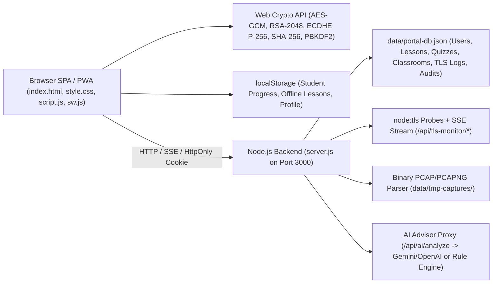

# TLS SECURITY LAB V3.0 — Academic Evaluation, Presentation & Viva Package

**B.Tech Computer Science & Engineering — Network Security & Cryptography Project**

---

## PART 1: PROJECT OVERVIEW

- **Project Title**: **TLS SECURITY LAB V3.0** — Interactive Cybersecurity, Cryptography & Network Analysis Learning Platform
- **Abstract**: TLS Security Lab V3.0 is a full-stack educational cybersecurity platform built with **HTML5**, **CSS3** (Burgundy Black `#160810` + Neon Pink `#FF6685` theme), **Vanilla JavaScript**, **Browser Web Crypto API (`window.crypto.subtle`)**, and a zero-dependency **Node.js backend (`server.js`)** using `node:tls`, `node:crypto`, Server-Sent Events (SSE), and persistent JSON storage (`data/portal-db.json`).
- **Problem Statement**: B.Tech CSE students struggle to connect theoretical cryptography (AES, RSA, ECDHE, SHA-256) and TLS/SSL handshakes with real network packet inspection, X.509 certificate validation, and secure backend engineering.
- **Project Objectives**:
  1. Execute real in-browser cryptographic primitives via Web Crypto API.
  2. Perform real backend TLS handshakes (`node:tls`) with live SSE telemetry and binary `.pcap`/`.pcapng` packet decoding.
  3. Provide a complete Student Learning Platform (35-lesson Academy, Quiz Center, 16 Challenges, Reports/QR Certificates, Career Prep, 6-Language Support, and Advanced Analytics).
  4. Enforce backend Role-Based Access Control (`admin`, `faculty`, `student`) with PBKDF2-SHA256 passwords and HMAC-SHA256 `HttpOnly` cookies.
- **Existing vs. Proposed System**:
  - *Existing*: Static textbooks, disconnected CLI utilities, and unintegrated quiz sites.
  - *Proposed*: Unified 23-section responsive PWA combining real cryptography, live TLS probing, binary PCAP analysis, AI guidance, Virtual Classroom collaboration, and data-driven analytics.
- **Scope & Key Contributions**: Real Web Crypto + Node.js `tls.connect()` instrumentation, zero-dependency binary PCAP/PCAPNG parser, RBAC Admin/Faculty/Classroom APIs, 104-term 6-language glossary, and PWA offline lesson caching.

---

## PART 2: SYSTEM ARCHITECTURE (ACTUAL IMPLEMENTATION)

- **Frontend Architecture**: Single-page responsive PWA (`index.html`, `style.css`, `script.js`, modular `*-data.js` banks, `manifest.json`, `sw.js`, `offline.html`).
- **Backend Architecture**: Zero-dependency Node.js `http` server (`server.js`) with rate limiting (`20` req/min + 5-min bucket pruning), `node:tls` live probing, binary PCAP/PCAPNG decoding, and RBAC middleware (`requireRoles`).
- **Database Architecture**: `data/portal-db.json` (server-side persistent store for RBAC users, classrooms, faculty content, TLS monitor history, and audit logs) + `localStorage` for client-side student telemetry.
- **Authentication Flow**: `POST /api/auth/login` verifies `PBKDF2-SHA256` (`100,000` iterations, 16-byte salt, `crypto.timingSafeEqual`) and sets an `HttpOnly; SameSite=Lax` HMAC-SHA256 signed cookie (`tls_portal_session`).
- **TLS Handshake Flow**: Animated 5-stage/8-message simulator in `script.js` paired with live `node:tls` probes (`ClientHello` → `ServerHello` → `Certificate` → `KeyExchange` → `Finished`) streamed over SSE.

---

## PART 3: LOGICAL FEATURE DEMONSTRATION SEQUENCE

1. **Student Dashboard (`#tabStudentDash`)**: Shows real overall completion %, lessons/labs/quizzes counters, daily challenge, and personalized greeting. *Observe*: Live KPI updates without fabricated numbers.
2. **Learning Academy (`#tabAcademy`)**: 5 modules (35 lessons) + faculty-published lessons, knowledge checks, Bilingual Mode, and "Save All Lessons Offline". *Observe*: Immediate progress bar & badge unlock updates.
3. **Practical Cryptography Lab (`#tabCrypto`)**: Real Web Crypto `ECDHE P-256`, `AES-128/256-GCM`, `RSA-2048 OAEP/PSS`, and `SHA-256` avalanche comparison. *Observe*: Matching 256-bit ECDH secrets and 96-bit CSPRNG IVs.
4. **Certificate Inspector (`#tabCertificate`)**: Inspects Valid, Expired, Untrusted Root CA, and Domain Mismatch X.509 scenarios. *Observe*: Trust chain rejection and Challenge validation sync.
5. **Attack Playground (`#tabSecurity`)**: Safe animated MITM, Replay, Eavesdropping, Spoofing, and Tampering demos with TLS Defense Shield. *Observe*: Plaintext interception vs. encrypted deflection.
6. **Live TLS Monitor (`#tabTlsMonitor`)**: Runs an authorized `node:tls` probe (e.g., `example.com:443`) over SSE. *Observe*: Real negotiated `TLSv1.3`, `TLS_AES_256_GCM_SHA384`, millisecond handshake time, and X.509 cert metadata.
7. **Packet & PCAP Inspector (`#tabPcapLab` & `#tabTerminal`)**: Loads `sample_tls13_capture.pcap` or uploaded `.pcap`/`.pcapng`, decodes Ethernet/IPv4/TCP/TLS headers, and marks `Application Data (0x17)` as encrypted. *Observe*: Protocol/size charts and isolated temp-file cleanup.
8. **Quiz Center (`#tabQuiz`)**: Timed MCQs across 6 categories and 3 difficulties with instant feedback and history persistence. *Observe*: Progress preserved across language switches.
9. **AI Cybersecurity Tutor (`#tabAiAdvisor`)**: Analyzes live session evidence, phishing URLs, and insecure crypto code (`AES-ECB`, `Math.random()`) via `POST /api/ai/analyze`. *Observe*: Clear separation between Verified Findings and AI/Rule explanations.
10. **Advanced Analytics Dashboard (`#tabAdvAnalytics`)**: Displays Line, Bar, Doughnut, and 8-domain Radar charts, 28-day heatmap, PDF/CSV export, and RBAC-protected Faculty Analytics (`403` for students).

---

## PART 4: TECHNICAL EXPLANATION (CONNECTED TO CODE)

- **TLS 1.2 vs TLS 1.3**: TLS 1.3 (RFC 8446) reduces handshakes from 2-RTT to 1-RTT by sending `key_share` in `ClientHello` and removes static RSA/weak ciphers.
- **ECDHE Key Exchange**: `crypto.subtle.generateKey({ name: 'ECDH', namedCurve: 'P-256' })` + `deriveBits()` establishes Forward Secrecy.
- **AES-GCM**: Authenticated Encryption with Associated Data (`AEAD`) using a fresh 96-bit CSPRNG IV (`crypto.getRandomValues(new Uint8Array(12))`) per encryption.
- **RSA & Digital Signatures**: `RSA-OAEP` for encryption and `RSA-PSS` (`sign`/`verify`) for authenticity and non-repudiation.
- **SHA-256 & Certificates**: `crypto.subtle.digest('SHA-256', ...)` demonstrates the avalanche effect; X.509 binds public keys to domains via trusted CAs.
- **MITM & Packet Inspection**: CA-signed X.509 verification stops MITM; PCAP inspection decodes plaintext headers (`ClientHello`/`ServerHello`) while leaving `0x17` Application Data encrypted.

---

## PART 5: ACTUAL TESTING REPORT

| Test Category | Result | Observed Evidence |
|---|---|---|
| **Syntax (`node -c`)** | **PASS** | All 8 `.js` files exited with code `0`. |
| **JSON Configs** | **PASS** | `manifest.json` and `vercel.json` valid. |
| **Static & PWA HTTP** | **PASS** | `/`, `/style.css`, `/script.js`, `/manifest.json`, `/sw.js`, `/offline.html`, `/icons/icon.svg` all returned `200`. |
| **Static Secret Block** | **PASS** | `/server.js`, `/.env`, `/data/portal-db.json` returned `403`. |
| **Auth & RBAC APIs** | **PASS** | Unauth `/api/admin/overview` → `401`; Student `/api/admin/overview` & `/api/analytics/faculty` → `403`; Faculty `/api/analytics/faculty` → `200`. |
| **AI & Multi-Lang API** | **PASS** | `POST /api/ai/analyze` (`kn`, bilingual) → `200`; invalid mode → `400`. |
| **Live TLS Probe & SSE** | **PASS** | SSRF `127.0.0.1` → `400`; `example.com:443` → `200` (`TLSv1.3`, `185ms`); `/api/tls-monitor/stream` → `200` SSE. |
| **PCAP Binary Parser** | **PASS** | `/api/pcap/sample` → `200` (8 packets); `evil.exe` → `400`; temp dir cleaned. |
| **Browser Responsive QA** | **PENDING** | Automated Chrome DevTools unavailable (`DevToolsActivePort` ENOENT); manual check required at `320px`–`1440px`. |

---

## PART 6: VIVA QUESTION BANK (10 CATEGORIES)

1. **Project Fundamentals (Beginner)**: *What problem does TLS Security Lab V3.0 solve?* — Bridges theory and practice with real Web Crypto execution, live `node:tls` probing, PCAP analysis, and student tracking.
2. **Computer Networks (Beginner)**: *What is the difference between Port 80, Port 443, and Port 53?* — Port 80 is plaintext HTTP, Port 443 is encrypted HTTPS (HTTP over TLS), and Port 53 is DNS.
3. **Network Security (Intermediate)**: *How does TLS prevent Replay and MITM attacks?* — Random nonces (`ClientHello`/`ServerHello`), sequence numbers, AEAD tags, and CA-signed X.509 certificates.
4. **Cryptography (Intermediate)**: *Why must AES-GCM never reuse an IV with the same key?* — Reusing an IV leaks the XOR of plaintexts and compromises the GHASH authentication key.
5. **TLS & SSL (Advanced)**: *How does TLS 1.3 prevent downgrade attacks?* — Embeds a fixed 8-byte sentinel in `ServerHello.random` checked by TLS 1.3 clients.
6. **Frontend Development (Intermediate)**: *How is XSS prevented when rendering student reports or chat history?* — Every user-controlled field is escaped via `escapeHtml()` and restricted by `Content-Security-Policy`.
7. **Backend Development (Advanced)**: *Why is RBAC enforced on the server rather than just hiding UI buttons?* — Attackers can call `/api/admin/*` directly with `curl`; `requireRoles()` verifies the signed `HttpOnly` cookie on every request.
8. **Database (Intermediate)**: *How is data stored and protected?* — Server records persist in `data/portal-db.json` (blocked from HTTP `403`), and passwords use salted `PBKDF2-SHA256` (`100k` iterations).
9. **AI Integration (Intermediate)**: *How are AI API keys protected and prompt outputs constrained?* — Keys remain in server `.env`, requests are rate-limited (`20`/min), and AI text is never auto-executed.
10. **Cybersecurity Applications (Beginner)**: *In a PCAP without session keys, what can an analyst see in TLS traffic?* — Ethernet/IP/TCP headers and plaintext `ClientHello`/`ServerHello` metadata, never encrypted `0x17` Application Data.

---

## PART 7: 15-SLIDE PRESENTATION OUTLINE (BURGUNDY BLACK `#160810` + NEON PINK `#FF6685`)

1. **Title**: TLS Security Lab V3.0 — Network Security & Cryptography Platform
2. **Introduction**: Interactive browser + Node.js cybersecurity learning environment
3. **Problem Statement**: Theory-practice gap in TLS, PKI, and packet analysis education
4. **Objectives**: Real Web Crypto, live `node:tls` probing, PCAP decoding, RBAC & Student Mode
5. **Existing vs. Proposed System**: Static slides vs. unified 23-section PWA lab
6. **Technology Stack**: HTML5, CSS3, ES6+ JS, Web Crypto API, Node.js (`http`, `tls`, `crypto`), Chart.js, jsPDF
7. **System Architecture**: Client SPA + PWA + Node.js Backend + `portal-db.json` diagram
8. **Main Features**: Academy, Quizzes, Challenges, Classroom, Career Prep, 6 Languages, Analytics
9. **TLS Handshake Demonstration**: 8-message TLS 1.3 flow + Live `node:tls` SSE Monitor
10. **Cryptography Demonstration**: Real ECDHE P-256, AES-256-GCM, RSA-2048, SHA-256
11. **Security Analysis**: Attack Playground, X.509 validation, PBKDF2, RBAC, SSRF & PCAP guards
12. **Testing Results**: Actual verified `node -c`, HTTP `200`/`403`/`401`, `node:tls`, and PCAP test outputs
13. **Advantages & Applications**: Zero external npm dependencies, offline PWA learning, B.Tech lab readiness
14. **Future Enhancements**: PostgreSQL migration, live `GEMINI_API_KEY` deployment, multi-host classroom sync
15. **Conclusion**: Complete, audited, demonstration-ready cybersecurity platform

---

## PART 8: PRE-DEMO CHECKLIST

- [x] `node server.js` running at `http://127.0.0.1:3000/` (`GET /api/health` → `200`)
- [x] Demo accounts ready: `admin@tlslab.edu` (`Admin@1234`), `faculty@tlslab.edu` (`Faculty@1234`), `student@tlslab.edu` (`Student@1234`)
- [ ] Open `http://127.0.0.1:3000/` in Chrome/Edge and verify visual layout across desktop & mobile DevTools (`375px`, `768px`, `1440px`)
- [ ] Optional: Copy `.env.example` to `.env` and add `GEMINI_API_KEY` or `OPENAI_API_KEY` for live LLM answers during demo
