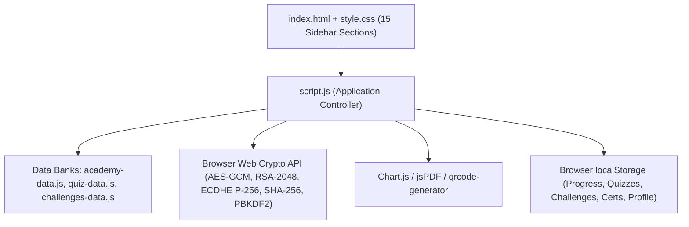

# Project Architecture — TLS SECURITY LAB V3.0

## 1. Architecture Overview
TLS Security Lab V3.0 is a **single-page, pure client-side static web application** (`index.html`, `style.css`, `script.js`, plus modular curriculum/data banks `academy-data.js`, `quiz-data.js`, `challenges-data.js`). There is **no separate backend server** and **no external SQL/NoSQL database**; all cryptographic operations execute natively in the browser via the **Web Crypto API**, and all student state persists locally in `localStorage`.

## 2. Frontend Architecture
- **Navigation Shell**: Fixed 250px vertical sidebar (`#appSidebar`) with responsive tablet/mobile drawer and 15 `content-section` views controlled by `navigateToSection(targetId)` and `SECTION_TITLES`.
- **Theming**: CSS custom properties in `:root` (Burgundy Black `#160810`, Cards `#29121F`, Borders `#78334F`, Accent `#FF6685`) with dynamic `body.theme-light`, `body.layout-compact`, and root font-size scaling (`applyAppearanceSettings()`).

## 3. Backend & Database Architecture
- **Backend**: None. Static assets are served directly (e.g., via `vercel.json` on Vercel or any HTTP static server).
- **Database**: None. Structured JSON persistence in `localStorage` (see [`DATABASE_SCHEMA.md`](./DATABASE_SCHEMA.md)).

## 4. Authentication Flow
Local account security in `tabProfile` (`tls_lab_account_auth_v1`):
1. Password creation/update validates `>= 8` characters with letters and digits.
2. `hashPasswordPbkdf2()` generates a 16-byte CSPRNG salt (`window.crypto.getRandomValues`) and derives a 256-bit key using `PBKDF2` (`100,000` iterations, `SHA-256`).
3. Stored format: `pbkdf2$<saltHex>$<hashHex>`.
4. Session resume (after logout) and account deletion require `verifyStoredPassword()` with `constantTimeEqual()`.

## 5. Cryptography Implementation
- **ECDHE P-256**: `crypto.subtle.generateKey({ name: 'ECDH', namedCurve: 'P-256' })` + `deriveBits()` for client and server keypairs.
- **AES-128/256-GCM**: `crypto.subtle.generateKey` + fresh 96-bit CSPRNG IV per encryption (`crypto.getRandomValues(new Uint8Array(12))`) + `encrypt()`/`decrypt()`.
- **RSA-2048**: OAEP encryption/decryption and PSS digital signing/verification.
- **SHA-256 / 384 / 512**: `crypto.subtle.digest()` for avalanche effect demos and Challenge Center hash validation.

## 6. Student Progress Tracking
`studentState` (`tls_lab_student_progress_v1`) records `completedLessons`, `completedLabs`, `labCompletionDates`, `completedChallenges`, `achievementDates`, `dailyActivityMap`, `timeBySection`, and `activities`. Every dashboard, badge gallery, report, and certificate eligibility check reads directly from this live state.

## 7. AI Integration
Not implemented in the current static frontend codebase.
